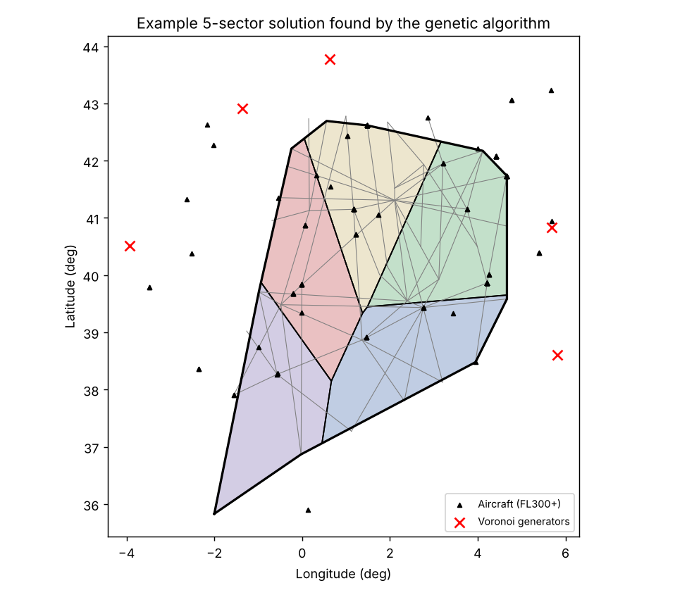
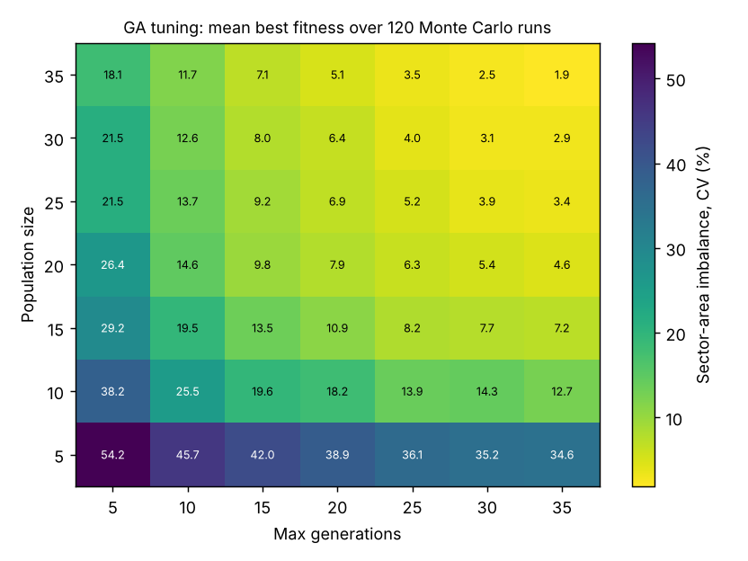
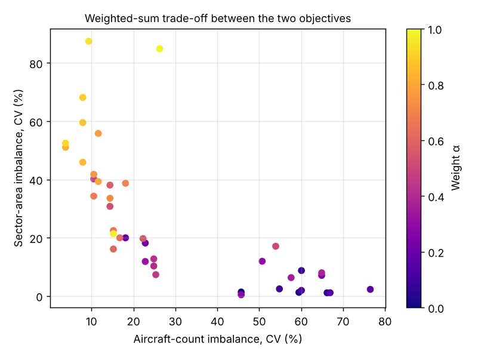

# Airspace Sectorisation with Voronoi Diagrams and Genetic Algorithms

MATLAB project that divides an airspace (a FIR over the east of the Iberian Peninsula, traffic above FL300) into 5 control sectors. Each sector is the Voronoi cell of a generator point, and a genetic algorithm moves the generators to balance the workload between sectors.

<p align="center"></p>

## How it works

- **Encoding:** a candidate solution (phenotype) is the list of the 5 generator coordinates, i.e. 10 variables (longitude, latitude).
- **Sectors:** the Voronoi diagram of the generators, clipped to the FIR boundary. For each sector the framework computes its area, the aircraft inside it, and the airway intersections and crossings.
- **Objectives** (`objectives_student/`): workload imbalance between sectors, measured as the coefficient of variation (std / mean, in %) of
  - the sector area, and
  - the number of aircraft per sector.
- **Optimisation:** single-objective GA (`ga` and the adaptive GA `aga`) and multi-objective optimisation, with a weighted sum and with `gamultiobj`.

## Studies

**1. Tuning the genetic algorithm** (`GA_Parameters_Optimization.m`, `MontecarloConvergence.m`)

The GA is stochastic, so each combination of population size and maximum generations was run 120 times (Monte Carlo) and the mean of the best fitness was recorded. Larger populations and more generations clearly give better solutions: the mean imbalance drops from 54 % with the smallest setting to 1.9 % with the largest one tested (35 × 35).

<p align="center"></p>

**2. Two objectives at the same time** (`multiObjectiveOptimization.m`, `functions_student/paretoPlots.m`)

Balancing the sector areas and balancing the number of aircraft per sector pull in different directions. Sweeping the weight α between both objectives (41 values) gives the trade-off below. The same problem was also solved with `gamultiobj` to obtain the Pareto front directly.

<p align="center"></p>

The figures in this README were replotted in Python from the results saved by the MATLAB scripts.

## How to run

```matlab
main_student                  % load airspace, run the GA and plot the sectors
GA_Parameters_Optimization    % population size / generations study
MontecarloConvergence         % how many Monte Carlo runs are needed
multiObjectiveOptimization    % weighted sum and gamultiobj
```

Requires MATLAB with the Global Optimization Toolbox (`ga`, `gamultiobj`). `multiObjectiveOptimization` uses `parfor` (Parallel Computing Toolbox), but also runs without it.

## Repository structure

```
data/                 airspace data: waypoints, airways, FIR and traffic snapshots
functions/            course framework: airspace loading, Voronoi geometry, complexity, plots, AGA
objectives_student/   our objective functions
functions_student/    our Pareto plots
*.m (root)            our main script and studies
```

## Credits

- Project for the air traffic management course (MGTA) at EETAC–UPC, autumn 2025. Team: Gerard Artó, Mateu Palomar and Andreu Bueno.
- The `functions/` folder and the airspace data come from the *SectorisationVoronoi* toolkit provided by the course (MIT License). The objective functions, the main script and the GA, Monte Carlo and multi-objective studies are our own work.

## Author

Andreu Bueno Álvarez — Aerospace Systems Engineering, EETAC–UPC.
